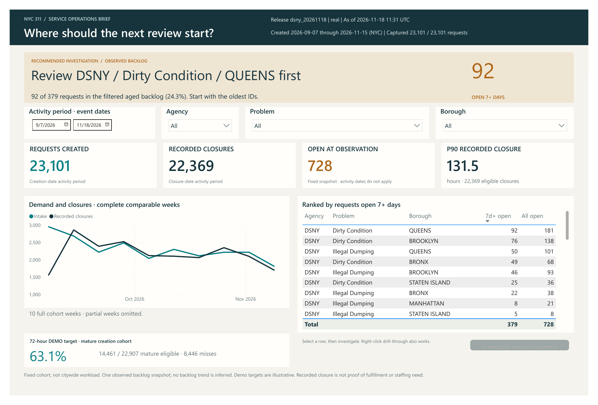
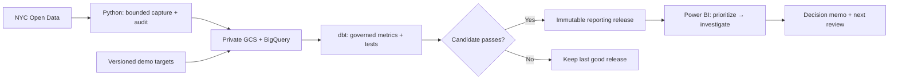

# NYC 311 · Service Operations Intelligence

**Scott McQueen · BI ownership, decision support, and reliable analytics**

## Turn a weekly operations review into a decision

An operations lead has thousands of service requests and limited time to investigate. Where should the next backlog review start—and can the team trust the answer after the next refresh?

This work sample demonstrates ownership of that whole problem: frame the decision, build the data product, explain the recommendation, and make the result reproducible. It combines an executive Power BI briefing with governed BigQuery metrics, tested recovery, and a practical handoff.

> **Review Queens · Dirty Condition first.**
> This segment holds **24.3% of the cohort's observed open requests aged seven days or more**, despite representing **14.2% of its intake**. Of its 181 open requests, **92 are at least seven days old and 38 are at least 30 days old**. Start with the oldest request IDs, check for later closure updates, and validate operational routing.

*Real NYC 311 data; a hypothetical operations decision. Scope: 23,101 DSNY Dirty Condition / Illegal Dumping requests created September 7–November 15, 2026, observed November 18 at 11:31 UTC. This is a fixed cohort, not the city's entire backlog. [Reproduce the priority comparison](artifacts/analysis/priority-context.json).*

**[See the Power BI briefing](artifacts/report/dsny_20261118/executive_v2/NYC311_dsny_20261118_executive.pdf)** · **[Read the one-page recommendation](docs/decision-memo.md)** · **[Inspect the implementation](docs/architecture.md)**



## What this demonstrates for your team

| A delivery problem | Judgment demonstrated here | Follow the evidence |
| --- | --- | --- |
| The weekly dashboard shows activity, but nobody knows what to do next. | Rank the aged workload, name the segment to review, and connect the recommendation to an oldest-first request worklist. Queens Dirty Condition has fewer cohort requests than Brooklyn, yet more requests still open after seven days. | [Priority analysis](artifacts/analysis/priority-context.json) · [Decision memo](docs/decision-memo.md) |
| Two reports disagree about the same KPI. | Define eligibility once, distinguish creation / closure / observation dates, and reconcile Power BI with warehouse results. An overdue open request counts as a demo-target miss; an immature request does not enter the denominator. | [Metric contract](docs/metrics.md) · [Request-level SQL](dbt/models/intermediate/int_case_metrics.sql) · [SQL/DAX results](artifacts/releases/dsny_20261118/sql_dax_bigquery_comparison.json) |
| A late source update or failed refresh undermines confidence. | Preserve captured observations, apply updates to stable request keys, and publish only a tested candidate. A demonstrated validation failure leaves the last good release available. | [Live replay and failure evidence](artifacts/replay/bigquery-replay.json) · [Recovery runbook](docs/runbook.md) |
| A useful prototype becomes someone else's maintenance problem. | Leave readable source, one runnable validation command, scoped cloud access, and measured cost evidence. Make the boundaries and trade-offs inspectable. | [Power BI source](powerbi/NYC311.pbip) · [Security design](docs/security.md) · [Measured benchmark](docs/benchmark.md) |

## Three choices worth discussing in an interview

**Prioritize aged workload.** Queens Dirty Condition has 3,273 cohort requests versus Brooklyn's 5,081, but 92 requests aged seven days or more versus 76. The recommendation follows the concentration of unresolved older requests. It is an investigation priority, not a claim about staffing or service fulfillment. [Calculation and source hashes](artifacts/analysis/priority-context.json).

**Test the answer across the full delivery path.** The original cloud-backed release passed 60 dbt data tests and 41 SQL/DAX comparisons in each Power BI mode. Matching counts initially concealed a connector timestamp defect; 33 explicit timestamp checks exposed it and verified the repair. That is why reconciliation includes dates, filters, empty slices, and eligible populations—not only headline totals. [Verification index](artifacts/verification-status.json).

The executive briefing adds [105 independently referenced checks](artifacts/report/dsny_20261118/executive_v2/qa/final_csv/briefing_comparison.json) for priority selection, complete weeks, date roles, and the investigation worklist. The saved reviewer report also passed a reopen without refresh; [both exported pages were visually inspected](artifacts/report/dsny_20261118/executive_v2/preview-verification.json).

**Make trade-offs explicit.** Immutable reporting tables use a little extra storage to give each import one consistent release. Keyless service accounts separate pipeline and reporting access. The query benchmark scanned 87.2% fewer bytes, but both jobs billed 10 MiB; the evidence supports a scan reduction, not a cost-saving claim. [Architecture](docs/architecture.md) · [Access checks](artifacts/security/gcp-reporter.json) · [Benchmark](docs/benchmark.md).

## Explore in the time you have

| Time | Start here |
| --- | --- |
| **One minute** | [Power BI PDF](artifacts/report/dsny_20261118/executive_v2/NYC311_dsny_20261118_executive.pdf) → [decision memo](docs/decision-memo.md). See the recommendation, the evidence, and the next action. |
| **Three minutes** | [Guided walkthrough](docs/walkthrough.md). Follow the decision into a metric, a recovery case, and a design trade-off. |
| **Five minutes** | [Warehouse model](dbt/models/intermediate/int_case_metrics.sql) → [DAX measures](powerbi/NYC311.SemanticModel/definition/tables/Metrics.tmdl) → [actual verification results](artifacts/verification-status.json). |
| **Hands-on** | [Report setup](docs/powerbi.md) and the bounded checks below. The CSV reviewer path needs no GCP credentials or paid Power BI sharing license. |

Download the verified **[executive PBIX and PDF](https://github.com/McQueen-Cloud-Advisory/nyc-311-service-ops-analysis/releases/tag/dsny_20261118-executive-v2)** or inspect the [briefing verification record](artifacts/report/dsny_20261118/executive_v2/README.md). The cached CSV reviewer report needs no GCP connection to view. The [original release](https://github.com/McQueen-Cloud-Advisory/nyc-311-service-ops-analysis/releases/tag/dsny_20261118) preserves the original PDF and native BigQuery PBIX. This repository is currently private; files and downloads require repository access.

## From source to a trusted briefing



Python · GoogleSQL · dbt Core · BigQuery · Power BI Import · Google Sheets / Docs. The included target CSV and Markdown memo keep the review path usable without Workspace access. [Detailed architecture and lineage](docs/architecture.md).

For a shipment-exception queue, the same design would use an exception ID in place of the 311 request key, verified event codes for resolution, and agreed targets by exception class. The transferable capability is a consistent path from an operational question to an explainable answer and a maintainable system.

## Run the bounded checks

Python 3.12, from the repository root:

```powershell
py -3.12 -m venv .venv
.\.venv\Scripts\python.exe -m pip install -e .
.\.venv\Scripts\python.exe -m nyc311 validate
```

No GCP connection is required. For the interactive reviewer report, use the included CSV exports with [Power BI setup](docs/powerbi.md). For a cloud run, see [GCP setup](docs/cloud-setup.md) and the [runbook](docs/runbook.md); `requirements.lock.txt` records the verified environment.

<details>
<summary><strong>Evidence scope, controls, and limitations</strong></summary>

- **Source:** official [NYC 311 dataset `erm2-nwe9`](https://data.cityofnewyork.us/Social-Services/311-Service-Requests-from-2020-to-Present/erm2-nwe9). Release `dsny_20261118`, snapshot `dsny_20261118_a`; [capture profile](artifacts/source/profile.json), [public extract](data/public/dsny_20261118_a.json.gz), and [executed SQL](artifacts/releases/dsny_20261118/sql_reconciliation.json).
- **Targets:** 72 elapsed hours for both selected problems, invented for this demonstration and labeled **demo targets**. Recorded closure does not establish field completion, handle time, or staffing need. Only actual captures establish observed backlog.
- **Reliability:** 24 live BigQuery replay/recovery checks use explicitly labeled synthetic inputs. They test late updates, repeat input, retained historical observations, and a failed validation gate. [Actual results](artifacts/replay/bigquery-replay.json).
- **Security:** private storage, minimal public fields, keyless pipeline access, and 26 passed reporting-role checks. The owner's Desktop OAuth login proves connector functionality; separate service-account probes establish reporting-role isolation. [Scope and evidence](docs/security.md).
- **Cost:** manual runs, no recurring compute schedule, and a $10 alert budget within the stated allowance. Alerts are not a spending cap. [Cleanup and operation](docs/runbook.md).
- **Workspace:** the native target Sheet and decision Doc have owner-only access. Repository CSV and Markdown copies are the reviewer path. The optional pipeline Sheets read returned HTTP 403; CSV is the working default. [Workspace artifact record](docs/workspace-artifacts.json).
- **Attribution:** this is an AI-assisted work sample. The [contribution note](docs/contribution-note.md) distinguishes Scott's direction and decisions from assisted implementation and recorded checks. No NYC operational improvement or sole authorship is claimed.

</details>
