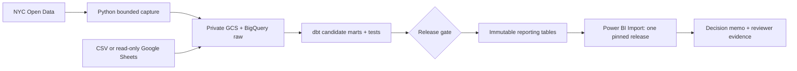

# NYC 311 Service Operations Intelligence

A reproducible briefing for a hypothetical operations lead choosing which service-request segment needs the next backlog review. Python captures a bounded public cohort, dbt/GoogleSQL builds governed BigQuery marts, and Power BI shows the evidence behind the decision.

**Finding:** review DSNY **Dirty Condition / Queens** first. At the November 18, 2026 capture, it has **181 observed open requests, including 92 aged at least seven elapsed days**, the largest older backlog among the selected segments. These are requests created September 7–November 15, 2026, not the city's entire backlog. Executed BigQuery SQL matches the local reference calculation; [the query and actual results](artifacts/releases/dsny_20261118/sql_reconciliation.json) preserve the evidence.

## Review paths

| Time | Follow this path |
| --- | --- |
| One minute | [Two-page Power BI preview](artifacts/report/dsny_20261118/NYC311_dsny_20261118_reviewer.pdf) → [decision memo](docs/decision-memo.md) → [portfolio case study](docs/portfolio-case-study.md) |
| Three minutes | [Walkthrough](docs/walkthrough.md), with the finding, metric definition, recovery case, and security trade-off |
| Five minutes | [Metric contracts](docs/metrics.md) → [request-level SQL](dbt/models/intermediate/int_case_metrics.sql) → [verification index](artifacts/verification-status.json) → [live replay/failure evidence](artifacts/replay/bigquery-replay.json) |
| Engineering review | [Architecture](docs/architecture.md), [security design](docs/security.md), [runbook](docs/runbook.md), and [evidence map](docs/evidence-map.md) |

The public extract and CSV reviewer exports are included. Open the prepared CSV-mode Power BI project without GCP credentials; [instructions and actual validation status](docs/powerbi.md) distinguish source validation from Desktop refresh. No paid Power BI sharing license is required for that path. The editable [target Sheet](https://docs.google.com/spreadsheets/d/1n88jxFlbe-H2ZwDIAA-GAxsmxoEkQE6Hfz8JtoGrRn0) and [decision Doc](https://docs.google.com/document/d/1gXshrmescOyhcQ2xDN1RHLpTedZ_XVzDpJuDxVOiGo8) remain private to their owner; the repository includes CSV and Markdown copies for reviewers.

Both Power BI pages were refreshed and inspected, including drill-through to Queens / Dirty Condition. [Actual report images and artifact details](artifacts/report/dsny_20261118/README.md) match the published release. The [versioned release](https://github.com/McQueen-Cloud-Advisory/nyc-311-service-ops-analysis/releases/tag/dsny_20261118) includes the PDF and native BigQuery PBIX. Use the PDF for immediate review or the [editable PBIP](powerbi/NYC311.pbip) to reproduce the interactive report. The native PBIX passed refresh and model checks before saving; reopening that saved file was not separately tested. The CSV reviewer PBIX was saved again after its original cached-reopen check and is held locally pending revalidation. This repository is private; its files and release downloads require repository access.

The real cloud release passed **all 60 dbt data tests**. Its [build results](artifacts/releases/dsny_20261118/dbt_results.json), [release audit](artifacts/releases/dsny_20261118/bigquery.json), and [SQL reconciliation](artifacts/releases/dsny_20261118/sql_reconciliation.json) identify the same release and snapshot. Power BI Desktop passed **41 SQL-to-DAX comparisons in each mode**: [CSV reviewer Import](artifacts/releases/dsny_20261118/sql_dax_comparison.json) and [native BigQuery Import](artifacts/releases/dsny_20261118/sql_dax_bigquery_comparison.json), including filtered, date-role, empty-slice, and p90 checks. Native Import also passed [33 UTC timestamp checks](artifacts/releases/dsny_20261118/powerbi_bigquery/timestamp_comparison.json) after a documented connector compatibility repair. The [measured benchmark](docs/benchmark.md) scanned **87.2% fewer bytes**, but both queries billed the same **10 MiB minimum**; this small demonstration establishes no billing or speed improvement.

## Run the bounded local checks

Python 3.12 is the verified runtime. From the repository root:

```powershell
py -3.12 -m venv .venv
.\.venv\Scripts\python.exe -m pip install -e .
.\.venv\Scripts\python.exe -m nyc311 validate
.\.venv\Scripts\python.exe -m nyc311 run --input data/public/dsny_20261118_a.json.gz --release-id dsny_20261118
.\powerbi\Prepare-LocalReport.ps1 -ExportRoot .\data\demo_exports -ReleaseId dsny_20261118
```

Open the PBIP path printed by the last command. If the Python launcher cannot find an existing interpreter, use its explicit executable path to create the environment. Local validation does not contact GCP. It verifies contracts, time conversion, eligibility, paging failure handling, security boundaries, and synthetic replay/recovery. The run command builds offline reference exports, clearly labeled as a Python reference rather than executed warehouse SQL.

For the GCP path, install `.[cloud]` instead of `.` and follow [cloud setup](docs/cloud-setup.md). `requirements.lock.txt` records the exact verified environment. The same captured input and CLI command work with `--cloud-config .local/cloud.json`; machine settings and credentials never belong in Git.

## Data scope and lineage

- **Source:** official [NYC 311 dataset `erm2-nwe9`](https://data.cityofnewyork.us/Social-Services/311-Service-Requests-from-2020-to-Present/erm2-nwe9).
- **Cohort:** DSNY; Dirty Condition and Illegal Dumping; local creation dates `[2026-09-07, 2026-11-16)`.
- **Capture:** November 18, 2026, 11:30:59–11:31:28 UTC; **23,101 requests**, with matching counts before and after extraction.
- **Release:** `dsny_20261118`; observation `dsny_20261118_a`; [input profile](artifacts/source/profile.json), [captured input](data/public/dsny_20261118_a.json.gz), [metrics and exclusions](data/demo_exports/dsny_20261118/verification.json).
- **Demo targets:** 72 elapsed hours for both categories, explicitly invented for this demonstration; [effective-dated CSV](data/targets/demo_targets.csv), optional read-only Sheets input.
- **Privacy:** request key, dates, status, agency, problem, borough, and channel only. No address, coordinates, descriptor, or resolution text.



Recorded closure is the agency's recorded outcome, not proof of fulfillment, staffing demand, handle time, or queue wait. Backlog exists only at actual captured observations. The source API does not promise an atomic snapshot; the extraction interval and stability checks are disclosed. Synthetic incidents are always labeled.

## Reliability, security, and cost evidence

| Claim | Implementation | Recorded evidence |
| --- | --- | --- |
| Late updates retain the request key and prior observations | [Local reference transactions](nyc311/release.py), [BigQuery runner](nyc311/cloud.py) | [24 passed live BigQuery checks using labeled synthetic inputs](artifacts/replay/bigquery-replay.json), [offline replay](artifacts/replay/local-replay.json) |
| Metrics have explicit eligibility and date roles | [dbt metrics](dbt/models/intermediate/int_case_metrics.sql), [DAX measures](powerbi/NYC311.SemanticModel/definition/tables/Metrics.tmdl) | [Native BigQuery SQL/DAX matches](artifacts/releases/dsny_20261118/sql_dax_bigquery_comparison.json), [CSV reviewer matches](artifacts/releases/dsny_20261118/sql_dax_comparison.json), [local tests](artifacts/validation/local.json) |
| Pipeline and reporting access are separated | [GCP setup](infra/Initialize-Gcp.ps1), [read-only verification](infra/Test-GcpSecurity.ps1) | [26 passed live checks](artifacts/security/gcp-reporter.json), [observed audit events](artifacts/security/audit-events.json), [scope limits](docs/security.md) |
| No credential files or sensitive source fields are required | [Source allowlist](nyc311/source.py), [read-only targets](nyc311/targets.py), [.gitignore](.gitignore) | [Security regression tests](tests/test_security.py) |
| Cost claims are measured on identical outputs | [Benchmark SQL](dbt/analyses/benchmark_optimized.sql), [bounded cloud runner](nyc311/cloud.py) | [Actual uncached jobs and equal outputs](artifacts/releases/dsny_20261118/benchmark.json), [interpretation and limits](docs/benchmark.md) |

Runtime service accounts receive no project Owner/Editor role. Storage is private with public access prevention; authentication uses short-lived impersonation rather than downloaded keys. A separate reporter service account supports positive-read and denied-write/raw-access checks. With one Google user, owner-authenticated Desktop access is **not** proof of least privilege. The project uses manual runs and a $10 alert budget within the stated $30 allowance; alerts are not a hard spending cap. Optional cleanup is documented.

## What this demonstrates

| Hiring signal | Verifiable work sample |
| --- | --- |
| Operational BI and investigation | A dated segment recommendation, drill-through report, exact source scope, and reproducible query |
| Analytics engineering and governed metrics | dbt lineage, request-level target matching, weighted rollups, case-level p90, and SQL/DAX reconciliation |
| Pipeline ownership | Audited extraction, immutable inputs, release gates, late-update replay, and failure recovery |
| Cloud engineering judgment | Scoped IAM, keyless access, private storage, measured query bytes, and bounded manual operation |
| Stakeholder communication | One-page memo, one-minute portfolio copy, three-minute walkthrough, and [contribution note](docs/contribution-note.md) |

This is a work sample using public data and a hypothetical stakeholder. Operational benefits are intended outcomes, not claimed improvements at NYC agencies. Review the contribution note before representing the work in an interview.
