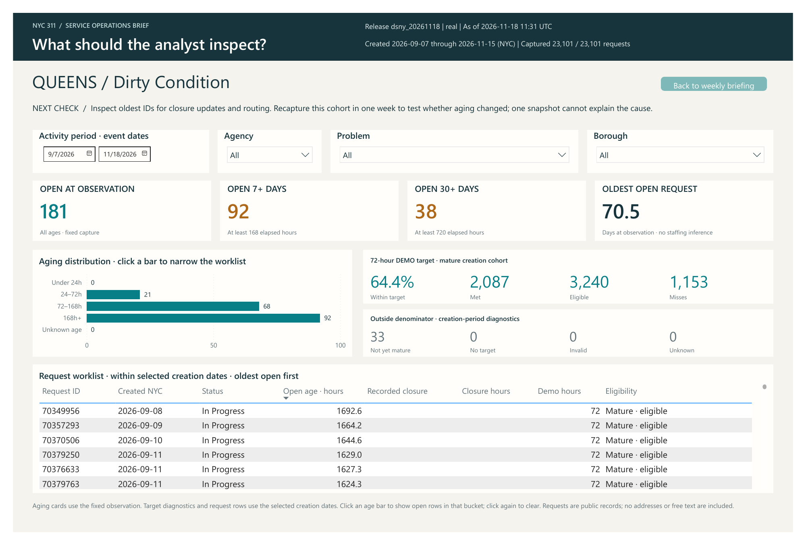

# A backlog decision that survives the next refresh

**Review Queens Dirty Condition first.** It holds **24.3% of the selected cohort's week-old backlog but only 14.2% of requests**. Start with its **38 requests open for at least 30 days**: check later closure updates and routing before proposing an intervention. [Reproduce the comparison](../artifacts/analysis/priority-context.json).

Queens had **3,273 requests versus Brooklyn's 5,081** for the same problem, yet **92 week-old open requests versus 76**. Aging concentration makes it the first review priority.

This work sample serves a hypothetical operations lead: 23,101 real DSNY Dirty Condition and Illegal Dumping requests created **September 7–November 15, 2026**, observed **November 18 at 11:31:28 UTC**. Release: `dsny_20261118`. This is a fixed cohort, not the city's entire backlog.

*Actual Power BI export, visually verified. The briefing connects the priority recommendation to its aged-backlog share and ten complete creation-cohort weeks.*

The Senior BIE ownership demonstrated connects **decision, trust, and reliable delivery**:

- **Define and prove the measures.** Creation, closure, and observation dates have separate roles; eligibility and weighted rates are explicit. The executive CSV report passed [105 briefing checks](../artifacts/report/dsny_20261118/executive_v2/qa/final_csv/briefing_comparison.json) and [41 core SQL/DAX comparisons](../artifacts/report/dsny_20261118/executive_v2/qa/final_csv/sql_dax_comparison.json).
- **Protect the weekly review.** Immutable releases preserve one capture across report tables. [24 live cloud checks](../artifacts/replay/bigquery-replay.json), using labeled synthetic inputs, demonstrated late updates, repeatable replay, and failed-candidate recovery.
- **Leave an operable handoff.** A [runbook](runbook.md), [tested access boundaries](security.md), and [measured cost trade-offs](benchmark.md) let another engineer inspect and reproduce the work.

*Verified Queens investigation: 181 open; 92 aged at least seven days; 38 at least 30 days; oldest 70.5 days. Age selection narrows the worklist while the captured backlog stays fixed. Static tables show their visible viewport; the interactive report contains the full worklist.*

For shipment exceptions, replace request IDs with exception IDs and define closure using verified resolution events. The intended benefit is an explainable next action and dependable reporting. The 72-hour thresholds are **demo targets**; recorded closure does not establish fulfillment or staffing needs. No operational improvement is claimed.

[Executive report PDF](../artifacts/report/dsny_20261118/executive_v2/NYC311_dsny_20261118_executive.pdf) · [Verification and delivery status](../artifacts/report/dsny_20261118/README.md) · [Decision memo](decision-memo.md) · [Three-minute demo](walkthrough.md) · [Repository](https://github.com/McQueen-Cloud-Advisory/nyc-311-service-ops-analysis)

Built with Codex assistance; [the contribution note](contribution-note.md) identifies responsibilities Scott can personally substantiate. Repository access is currently required for linked artifacts.
