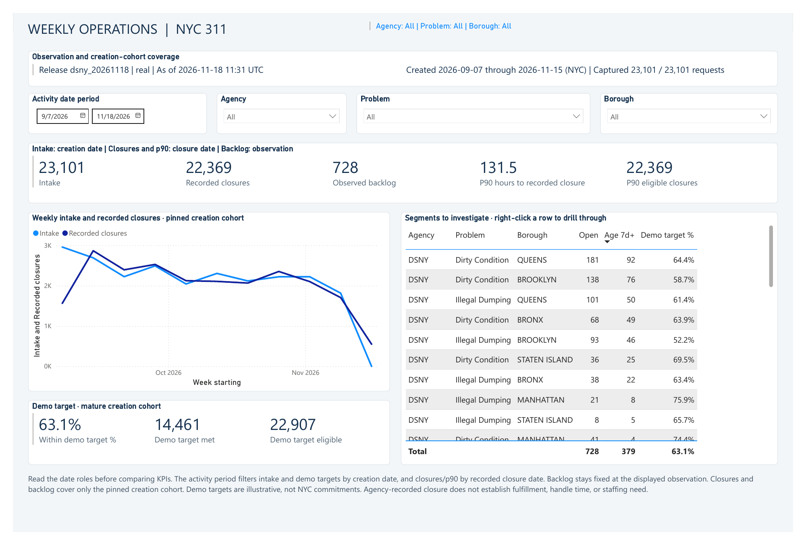
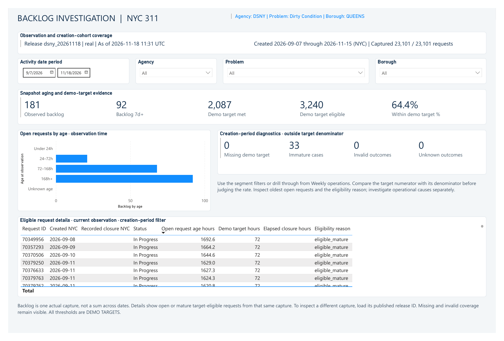

# Where should the next backlog review start?

**Queens Dirty Condition requests:** 181 were open at the November 18, 2026 observation, and 92 had been open for at least seven elapsed days—the largest aged backlog among the selected segments. The recommendation for a hypothetical operations lead is to review those oldest requests for source closure updates and operational routing before proposing an intervention.

The scope is 23,101 real DSNY requests for Dirty Condition and Illegal Dumping, created September 7–November 15, 2026, captured at **11:31:28 UTC on November 18**. This fixed cohort is not the city's entire backlog. Release: **`dsny_20261118`**.

In this segment, **2,087 / 3,240 eligible requests (64.4%)** met a 72-hour **demo target**; 33 immature requests were excluded. Recorded closure cannot establish fulfillment or staffing need. [Decision memo](decision-memo.md) and [executed SQL with outputs](../artifacts/releases/dsny_20261118/sql_reconciliation.json).

*Actual Power BI CSV reviewer export, release `dsny_20261118`: the full selected cohort has 728 open requests; Queens Dirty Condition ranks first with 92 aged at least 168 hours. The activity period controls intake by creation date and closures/p90 by closure date; backlog stays fixed at the displayed observation.*

*The same capture, filtered to DSNY / Dirty Condition / Queens: 181 open, 92 aged at least 168 hours, and 2,087 / 3,240 meeting the demo target (64.4%). The investigation shows age buckets, 33 immature exclusions, and request-level details. These images are rendered directly from the verified Desktop PDF export. Static exports contain each table's visible viewport; full rows are available in the interactive PBIX.*

[Read the two-page report PDF](../artifacts/report/dsny_20261118/NYC311_dsny_20261118_reviewer.pdf) or [download the verified cached reviewer PBIX](https://github.com/McQueen-Cloud-Advisory/nyc-311-service-ops-analysis/releases/download/dsny_20261118/NYC311_dsny_20261118_reviewer.pbix). Both previews need no GCP credentials. The repository is private, so viewing these files or downloading release assets requires repository access. Refreshing the PBIX's CSV source requires the reviewer configuration below.

Python captures minimal fields; dbt and GoogleSQL define governed BigQuery marts; a two-page Power BI Import project supports investigation. Explicit creation, closure, and observation dates clarify each KPI. Immutable release tables keep imports on the same capture and target version.

Evidence includes [request-level SQL](../dbt/models/intermediate/int_case_metrics.sql), the [finding query](../dbt/analyses/segment_investigation.sql), [60 passed dbt data tests](../artifacts/releases/dsny_20261118/dbt_results.json), and [24 passed live BigQuery replay/recovery checks using synthetic inputs](../artifacts/replay/bigquery-replay.json). The [same-output benchmark](benchmark.md) reduced processed bytes by **87.2%**, but both queries billed 10 MiB: no billed-byte saving. [Security evidence](security.md) covers private storage, keyless access, and reporting isolation, with limits stated.

For a shipment-exception queue, replace the request key with an exception ID, define resolution using verified event codes, and agree on targets by exception class. The intended benefit is a reproducible, explainable review; no NYC operational improvement is claimed.

[Open the editable Power BI project and reviewer instructions](powerbi.md) · [Repository](https://github.com/McQueen-Cloud-Advisory/nyc-311-service-ops-analysis) · [Three-minute walkthrough](walkthrough.md) · [Contribution note](contribution-note.md)

---

**Publication status.** BigQuery SQL matches the local reference, and the cloud benchmark is recorded. Desktop passed all 41 SQL–DAX comparisons in both [CSV reviewer mode](../artifacts/releases/dsny_20261118/sql_dax_comparison.json) and [native BigQuery Import](../artifacts/releases/dsny_20261118/sql_dax_bigquery_comparison.json); [33 native timestamp checks](../artifacts/releases/dsny_20261118/powerbi_bigquery/timestamp_comparison.json) also passed. Both CSV-mode report previews above were visually inspected. Native [Google Doc](https://docs.google.com/document/d/1gXshrmescOyhcQ2xDN1RHLpTedZ_XVzDpJuDxVOiGo8) and [target Sheet](https://docs.google.com/spreadsheets/d/1n88jxFlbe-H2ZwDIAA-GAxsmxoEkQE6Hfz8JtoGrRn0) have owner-only access; repository readers can use Markdown and CSV. The optional ADC Sheets read returned HTTP 403 with undetermined cause; CSV remains the working default.

**Repository delivery:** source, PDF, PNGs, and evidence are available in GitHub, with cached PBIX files attached to [release `dsny_20261118`](https://github.com/McQueen-Cloud-Advisory/nyc-311-service-ops-analysis/releases/tag/dsny_20261118). This is a private repository release, not a public portfolio-site publication. Before placing this copy on Scott's portfolio site, provide viewer-accessible hosting for the selected artifacts, replace repository-relative links with verified versioned links, and review the contribution note. Keep the release ID, scope, and captions with both previews.

The native refresh used the owner's OAuth login, so it proves connector functionality, not read-only effective access. Separate reporter-role checks establish the scoped access design; the CSV preview remains the credential-free review path. No operational outcome is claimed. The byte reduction is specific to the bounded benchmark, not a production savings estimate.
